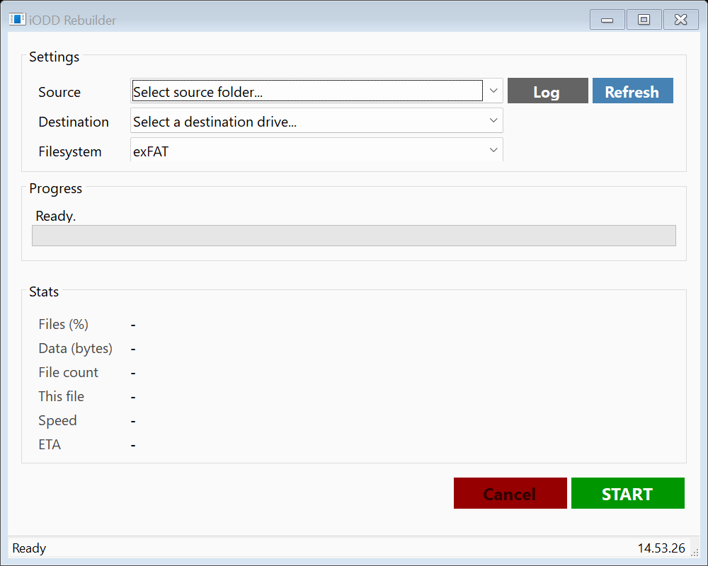
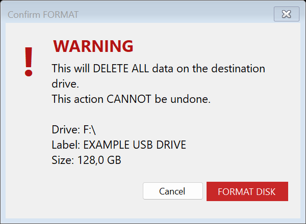

# iODD Rebuilder

Rebuild a USB-connected iODD image library from a separate local folder: **validate → confirm → format → sequential copy**.

Large disk images (`.iso`, `.img`, `.vhd`, `.vhdx`) are copied first, largest first, with file and byte progress, speed, ETA, and a per-run log. Starting from a freshly formatted volume aims to reduce fragmentation; contiguous allocation and performance gains are **not guaranteed**.

> [!CAUTION]
> **Every rebuild permanently erases ALL data on the selected destination volume.**
> Back up both your image library and anything on the destination before starting. Verify the drive letter and label yourself. Cancellation cannot undo formatting and can leave an incomplete library. This is not a recovery or backup tool.

> [!WARNING]
> The safeguards described below apply to source builds. The existing **v1.0.0 release does not include them**. Do not use that older binary to evaluate these protections. No new release is published by this change.

## Screenshots

Current Windows Forms interface (idle):



Destructive confirmation (example drive; no formatting performed for this capture):



## Download and requirements

1. Open [Releases](https://github.com/thalf/ioDD-Rebuilder/releases).
2. The existing package is `ioDD-Rebuilder_v1.0.0_win-x64.zip`. Read the warning above before considering it; wait for a reviewed release to obtain these safeguards, or build this branch for evaluation.
3. Extract the entire ZIP to a folder on a drive other than the destination. Launch `ioDDRebuilder.exe`.
4. Framework-dependent builds require the **[.NET 8 Desktop Runtime](https://dotnet.microsoft.com/en-us/download/dotnet/8.0)** matching the application architecture (x64 for the existing package). The base .NET Runtime alone is insufficient for Windows Forms.

Supported application platform: **Windows 10/11 desktop**. The published package targets **Windows x64**. Linux and macOS are unsupported; Windows ARM64/x86 builds have not been validated. Use a Windows version supported by Microsoft and compatible with .NET 8.

Formatting requires Windows PowerShell and the Windows Storage module, plus administrator approval through UAC. The GUI normally runs without elevation.

This revision accepts only writable **USB-connected** destination disks with an unambiguous drive-letter mapping. Internal disks, network paths, virtual disks, and unidentifiable storage are rejected. Source folders must be local and on a separate physical disk. Links, junctions, and mounted folders in the source path or tree are rejected.

## Usage

1. Back up your data. Connect the intended iODD USB drive and close programs using it.
2. Run the app from a different drive. Keep your source library on a separate physical disk and leave it unchanged throughout the rebuild.
3. Choose **Source → Browse…**, then **Refresh** and select the **Destination**. Check its drive letter, label, and size.
4. Choose **exFAT**, **NTFS**, or **FAT32**, according to your iODD model's filesystem support. FAT32 is rejected for volumes above 32 GiB or files of 4 GiB or larger.
5. Click **START**. Before erasure, the app scans files for readability, rejects unsafe paths and shared/system disks, and checks capacity with a reserved margin for filesystem overhead. The estimate cannot guarantee that every collection will fit.
6. Read the irreversible data-loss warning. Click **FORMAT DISK** only after verifying the destination, then approve UAC. Enter and Escape default to Cancel.
7. Wait for formatting and copying to finish. **Cancel** requests a stop during copying; controls remain locked until the worker stops. Formatting itself cannot be cancelled from the GUI.
8. Use **Log** to inspect `%TEMP%\iodd_rebuilder_*.log`. Check copied files and test the image library on your iODD before deleting your source backup.

The confirmation dialog shows the freshly inspected label and capacity. Destination disk/volume identity is checked again inside the elevated process immediately before formatting, and once more before copying. All copy writes use the confirmed volume GUID path instead of its drive letter, so reassignment of that letter cannot redirect the copy to another volume. A formatting error stops the rebuild: there is no DiskPart retry, whole-disk reset, or recursive cleanup fallback. These checks reduce accidental erasure risk; they cannot protect against hardware faults or devices being changed during the operation.

Folders are recreated, then files are copied sequentially. `Thumbs.db`, `desktop.ini`, and legacy `iodd_push*` helper/log filenames listed in the source code are excluded. File metadata, ACLs, and cryptographic verification are not preserved/performed.

## Build and non-destructive tests

Install the **.NET 8 SDK** (or a compatible newer SDK with .NET 8 targeting packs) on Windows:

```powershell
dotnet build ioDDRebuilder/ioDDRebuilder.csproj -c Release
dotnet build ioDDRebuilder.Formatter/ioDDRebuilder.Formatter.csproj -c Release
dotnet run --project tests/SafetyTests.csproj -c Release -- docs/images
./tests/Test-StorageGuard.ps1
```

Tests exercise input rejection, source scanning, filesystem/capacity checks, and elevated guard generation without executing formatting. Source-link tests require Windows Developer Mode or permission to create symbolic links. CI also parses the generated PowerShell syntax and runs 14 mocked storage scenarios (system/source disks, read-only/offline/internal disks, changed identities, and command failures). Hardware formatting, UAC cancellation, unplug/replug, and iODD compatibility still require manual validation on a backed-up disposable USB device before release.

Optional framework-dependent Windows x64 publish:

```powershell
dotnet publish ioDDRebuilder/ioDDRebuilder.csproj -c Release -r win-x64 --self-contained false
```

The separate `ioDDRebuilder.Formatter` console helper is for maintainers. It requires a destination root and source folder, shares the safety checks, and requires typing the exact erase confirmation. It formats only; it does not copy files.

## Suggested GitHub topics

`iodd`, `windows`, `winforms`, `csharp`, `dotnet`, `usb`, `disk-image`, `iso`, `exfat`, `ntfs`

## License

[MIT](LICENSE).
